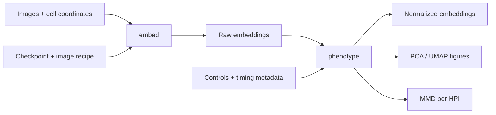

# Start here: embed and phenotype

Use `embed` to extract raw embeddings.
Use `phenotype` to compare treated cells with controls.



## Run

Run commands from the VisCy repository root.

1. Copy the [DynaCell/DynaCLR template](embed_dynacell.yaml) or [CELL-DINO template](embed_cell_dino.yaml) to `embed.yaml`.
2. Keep [cell_dino_recipe.yaml](cell_dino_recipe.yaml) beside the CELL-DINO manifest.
3. Fill the selected template's input paths, checkpoint checksum and metadata.
4. Copy [phenotype.yaml](phenotype.yaml) to the repository root.
5. Set its `feature_space` and control metadata to match your embeddings.

```bash
uv sync --locked --package dynaclr --extra eval

uv run --no-sync python -m dynaclr.evaluation.organelle_workflow embed \
  --manifest embed.yaml --output results/embed

uv run --no-sync python -m dynaclr.evaluation.organelle_workflow phenotype \
  --manifest phenotype.yaml --output results/phenotype
```

The phenotype template reads `results/embed/predictions.zarr`.
That file contains raw embeddings, despite its filename.
Use a new output directory for each run.

## File map

| File or folder | Purpose |
| --- | --- |
| [embed/SKILL.md](../../skills/embed/SKILL.md) | Agent instructions for checkpoint selection and image preprocessing. |
| [phenotype/SKILL.md](../../skills/phenotype/SKILL.md) | Agent instructions for control normalization, UMAP and MMD. |
| [CONTRACT.md](CONTRACT.md) | Input fields, normalization rules and output formats. |
| [organelle_workflow.py](../../src/dynaclr/evaluation/organelle_workflow.py) | Command entry point, metadata checks, classifier calls and plotting. |
| [organelle_inference.py](../../src/dynaclr/evaluation/organelle_inference.py) | Paper DynaCLR image preprocessing and inference. |
| [organelle_normalization.py](../../src/dynaclr/evaluation/organelle_normalization.py) | Control normalization and embedding export. |
| [organelle_mmd.py](../../src/dynaclr/evaluation/organelle_mmd.py) | MMD statistics and uncertainty calculations. |
| [tools/](tools/) | Optional paper-data inventory and small example. |
| [verification/](verification/README.md) | Paper comparison scripts and numerical evidence. |
| [test_organelle_workflow.py](../../tests/test_organelle_workflow.py) | Automated regression tests. |

Image normalization belongs to `embed`.
Control-relative embedding normalization belongs to `phenotype`.
MMD uses PCA features, not UMAP coordinates.

The [verification report](verification/README.md) describes component tests, not complete Figure 6 reproduction.
Witness scoring and temporal alignment remain outside these skills.
