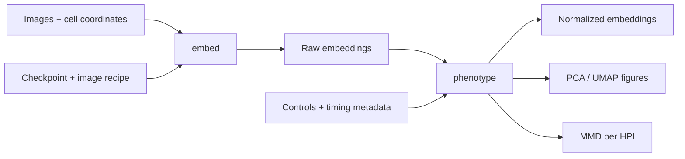

# Start here: embed and phenotype

Use `embed` to extract raw embeddings.
Use `phenotype` to compare treated cells with controls.



## Run

Run commands from the VisCy repository root.

Give the agent data paths and an existing configuration, if available.
Otherwise, the agent completes the appropriate template from your files and experimental facts:

- [DynaCell/DynaCLR](embed_dynacell.yaml) or [CELL-DINO](embed_cell_dino.yaml) for embedding.
- [Phenotype](phenotype.yaml) for population analysis.

TODO comments mark fields that need supplied values or checks.
Optional comments identify settings with usable defaults.
Any YAML filename works; copying or renaming it is optional.

| Responsibility | Work |
| --- | --- |
| Human | Supply inaccessible data paths, checkpoint preferences and experimental facts absent from metadata. |
| Agent | Inspect files, prepare supported inputs, complete YAML, calculate checkpoint hashes, validate inputs and run commands. |
| CLI | Execute inference or analysis from completed YAML and write outputs. It does not ask questions or resolve TODO comments. |

The agent asks only for unresolved facts, including control identities, replicate assignments and experimental timing.
The agent copies phenotype `feature_space` from embedding output; it does not ask you to calculate SHA-256.
You can also complete the YAML and run the commands directly without an agent.
The runner rejects `replace-with-...` placeholders; comments and plausible example values do not trigger validation.
For other data formats, follow [data preparation](CONTRACT.md#prepare-external-data).
For nuclear labels without tracking, use the [label-input configuration](CONTRACT.md#data-without-tracking) with the same `embed` command.

Install the environment once:

```bash
uv sync --locked --package dynacell --extra profiler
source .venv/bin/activate
```

Run with your configuration paths:

```bash
dynacell embed --config /path/to/embedding.yml --output results/embed
dynacell phenotype --config /path/to/phenotype.yml --output results/phenotype
```

Set the phenotype configuration's `embeddings` to the generated `predictions.zarr`.
Set `normalization.mode` to `per_timepoint` or `pooled` to choose how controls are grouped across time.
The default is `per_timepoint`, without smoothing; see the [normalization options](CONTRACT.md#analysis).
Relative input paths resolve against the configuration's `root`, relative to its directory.
This includes CELL-DINO's `training_config` recipe path.
Use a new output directory for each run.

Without activation, prefix commands with `uv run --locked --package dynacell --extra profiler`.
`--no-sync` is optional for environments already synchronized before a job.
It skips environment synchronization; the default instructions do not require it.

## File map

| File or folder | Purpose |
| --- | --- |
| [embed/SKILL.md](../../skills/embed/SKILL.md) | Agent instructions for checkpoint selection and image preprocessing. |
| [phenotype/SKILL.md](../../skills/phenotype/SKILL.md) | Agent instructions for control normalization, UMAP and MMD. |
| [CONTRACT.md](CONTRACT.md) | Input fields, normalization rules and output formats. |
| [dynacell CLI](../../../dynacell/src/dynacell/__main__.py) | Routes `embed` and `phenotype` to the workflow runner. |
| [organelle_workflow.py](../../src/dynaclr/evaluation/organelle_workflow.py) | Command entry point, metadata checks, classifier calls and plotting. |
| [organelle_inference.py](../../src/dynaclr/evaluation/organelle_inference.py) | Paper DynaCLR image preprocessing and inference. |
| [organelle_cells.py](../../src/dynaclr/evaluation/organelle_cells.py) | Label centroids, independent-instance tables and crop exclusions. |
| [organelle_normalization.py](../../src/dynaclr/evaluation/organelle_normalization.py) | Control normalization and embedding export. |
| [organelle_mmd.py](../../src/dynaclr/evaluation/organelle_mmd.py) | MMD statistics and uncertainty calculations. |
| [tools/](tools/) | Optional paper-data inventory and small example. |
| [verification/](verification/README.md) | Paper comparison scripts and numerical evidence. |
| [test_organelle_workflow.py](../../tests/test_organelle_workflow.py) | Automated regression tests. |

Image normalization belongs to `embed`.
Control-relative embedding normalization belongs to `phenotype`.
MMD uses PCA features, not UMAP coordinates.

The [verification report](verification/README.md) describes component tests, not complete Figure 6 reproduction.
Witness scoring and temporal alignment remain outside these skills.
