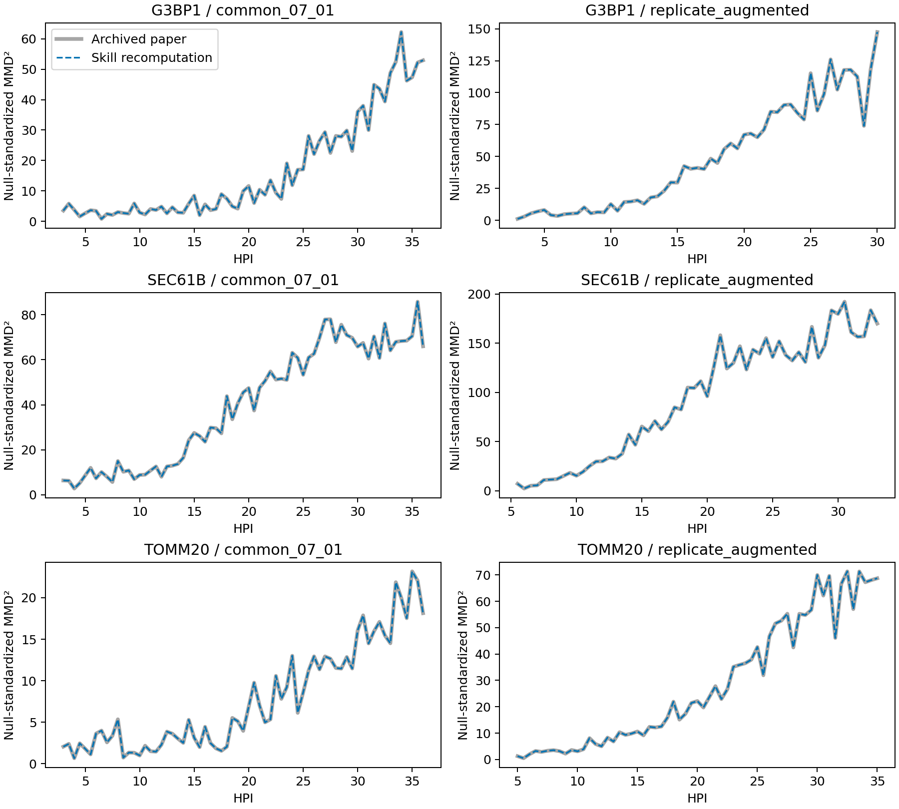

# Comparison with the organelle dynamics paper

Executed on 2026-11-17 using the archived ZIKV paper cohort, checkpoint `epoch=105-step=84800.ckpt`, and an NVIDIA A40. Numerical reports are versioned alongside this document. Generated arrays, tables, logs and PDF/PNG figures are retained under `/hpc/projects/intracellular_dashboard/organelle_dynamics/tmp-test-skill/publication-validation/`.

The following results validate individual workflow components.
They do not establish complete Figure 6 reproduction.
The original checks used four skills; the current interface contains `embed` and `phenotype`.

## Results

| Stage | Compared data | Result | Evidence |
| --- | --- | --- | --- |
| Image inference | 96 fresh cell crops: eight controls and eight treated cells in each of six marker/dataset pairs; track IDs omitted from input | All embedding comparisons passed. Maximum absolute difference: 0.000383; minimum cosine similarity: 0.99999982. | [Inference report](validation/inference.json) |
| Infection classification | Same saved classifiers applied to fresh and archived embeddings | 96/96 labels agree. Maximum probability difference: 0.0002074. | [Classifier report](validation/classifiers.json) |
| Control normalization | All 257,856 matched observations across SEC61B, TOMM20 and G3BP1 | Exact equality with the original normalization implementation. | [Normalization report](validation/normalization.json) |
| Cached PCA transforms | Same observations transformed by the archived fitted PCA models: 48 TOMM20, 74 SEC61B and 85 G3BP1 components | Exact equality with every archived PCA score. | [PCA report](validation/normalization.json) |
| HPI MMD | 371 bins across three markers and both dataset scopes; nine numerical metrics per bin | All 3,339 comparisons pass. Maximum absolute difference: 2.85 × 10⁻¹⁴. | [MMD report and input hashes](validation/mmd.json) |
| Matched sample integrity | Every reference HPI bin | Control/treated counts, paired dataset, exact paired HPI and unique lineage membership checked. | [Verification implementation](verify_paper.py) |
| External metadata | Renamed ID/treatment fields, derived HPI, no track fields | Updated population-analysis tables agree exactly with the corresponding canonical-metadata run. | `publication-validation/external-analysis/` |



The overlay shows subsample-median MMD curves. The numerical comparison also checks the unbiased MMD², permutation p-value, null mean, null standard deviation, standardized null 95th percentile, standardized MMD, and both subsampling interval endpoints.

## Methods and tolerances

Fresh inference uses the paper Triplet crop/resize/normalization implementation through a coordinate-only adapter. Its explicit recipe is FOV mean/std normalization, Phase3D focus, a 16-reference-slice window with offset 0.3, MIP for fluorescence, XY reference sampling 0.1494 µm, Z reference sampling 0.174 µm, and 160 × 160 model crops. Float32 matrix multiplication is pinned to `highest`. Adapter sentinel columns satisfy the legacy reader interface; they are not exported as biological track identities.

Embedding and classifier-probability replay use `atol=5e-4`, `rtol=1e-4`; embedding cosine similarity must also be at least 0.999999. Classifier labels must agree exactly. These tolerances allow small floating-point replay differences while reporting their measured magnitude. A preliminary probability check with `atol=1e-4` flagged two of the six dataset pairs; the largest discrepancy was 0.0002074 and no labels changed. The final reports use the same absolute numerical budget for embeddings and probabilities.

MMD uses the archived matched pairs, PCA scores, bandwidths and seeds, with 200 permutations and 50 paired 80% subsamples. The corrected shared estimator uses `ddof=1` for the permutation-null standard deviation and selects the same subsample indices from each side of a matched pair. Its comparison tolerance is `atol=1e-6`, `rtol=1e-5`; observed errors are at floating-point roundoff scale. A separate rerun of the original cohort-selection/curve code also reproduced all 371 archived HPI rows exactly.

The normalization comparison recomputes control centering and MAD scaling from the original marker embeddings using the same matched observations. PCA verification applies the saved fitted models; it does not refit PCA on a new population. The paper cohort uses onset-selected lineages. The default population-analysis command uses all treated cells, as configured in its input contract. To compare numeric results, hold both cohort and fitted representation fixed. This verification replays the frozen HPI analysis; it does not recompute infection-time alignment.

## Rerun

Run from the VisCy repository root with its synchronized environment. Set `PAPER_REFERENCE` to `direct_pal_lineage_native30_same_cohort_alignment/`, the parent of the supplied `paper_figure_pseudotime/` directory. Set `PREDICTION_ROOT` to its ancestor `epoch105-step84800/`. Each output directory must be new.

```bash
# Fresh coordinate-only inference across all six paper marker/dataset pairs
uv run --no-sync python applications/dynaclr/examples/organelle_dynamics/verify_inference.py \
  --output results/verify-inference

# Saved classifiers: fresh embeddings versus archived embeddings
uv run --no-sync python applications/dynaclr/examples/organelle_dynamics/verify_classifiers.py \
  --inference-results results/verify-inference \
  --prediction-root "$PREDICTION_ROOT" --output results/classifier-comparison.json

# Full matched-cohort normalization and archived fitted PCA transforms
uv run --no-sync python applications/dynaclr/examples/organelle_dynamics/verify_normalization.py \
  --reference "$PAPER_REFERENCE" --output results/verify-normalization

# Recompute all archived HPI MMD bins using the skill's shared estimator
uv run --no-sync python applications/dynaclr/examples/organelle_dynamics/verify_paper.py \
  --reference "$PAPER_REFERENCE" --output results/verify-mmd
```

The inference and normalization verifiers use the dataset list in the original paper analysis script. Those source assets must be available at the recorded paths. `verify_paper.py` needs only the frozen reference bundle: curve table, matched-sample manifest, per-marker PCA scores and run parameters. It writes the comparison table, recomputed curve table, numerical report and overlay figure.

Sixteen focused tests pass, including regression tests for the null standard deviation and paired subsampling. The updated population-analysis and external-metadata smoke runs also pass after these corrections.


## Explicit normalization and plotting steps

The extracted normalizer was rechecked on all 257,856 paper observations: control-normalized vectors and archived fitted PCA transforms still agree exactly under the original numerical environment. The new `normalize → plot/analyze` sequence was also run on the 192-observation, 768-feature SEC61B smoke cohort. [Machine-readable results](validation/steps.json) record:

- Raw encoder vectors preserved exactly in Zarr and Parquet.
- `ctrl-norm-embedding` Parquet vectors exactly equal `obsm/X_control_mad` in Zarr.
- Saved normalization reused unchanged by plotting and analysis.
- Separate plotting and combined analysis produce identical PCA/UMAP coordinates.
- Saved classifier predictions and all MMD curve columns exactly match the prior population analysis.

Regression tests additionally check independent control fitting across markers, experiments and control groups; repeated normalization starting from raw X; rejection of changed cohorts/controls/vectors; and raw-feature classifier inputs. All four skill validators pass.

Outputs are under `publication-validation/explicit-normalization-steps-final/`, including `normalized/normalization.json`, `normalized/embeddings.parquet`, `normalized/normalized.zarr`, and PCA/UMAP figures in `plots/`. Full-cohort recheck results are in `publication-validation/explicit-normalization-paper-final/normalization_comparison.json`.

An initial run constrained BLAS to one thread and produced small PCA roundoff differences (maximum 1.91e-5 in cached scores; smoke bandwidth 1300.042724609376 versus 1300.042480468751). Control normalization itself remained exact. Restoring the original thread settings restored exact PCA and MMD agreement; comparison tolerances were not widened.

```bash
# Reference is a completed population-analysis bundle, containing resolved_manifest.yaml.
uv run --no-sync python applications/dynaclr/examples/organelle_dynamics/verify_steps.py \
  --reference path/to/population-analysis --output results/verify-steps
```


## Two-skill interface

The current skills are `embed` and `phenotype`.
Image preprocessing belongs to `embed`.
Control-relative embedding normalization belongs to `phenotype`.

| Check | Result |
| --- | --- |
| CELL-DINO `embed` | Two real cell crops produce finite 1,024-feature embeddings. Parquet exactly preserves the raw vectors. |
| Embedding-only output | No classifier predictions or control-normalized embeddings appear in the CELL-DINO output. |
| `phenotype` | 192 paper observations retain exact raw vectors, normalized exports and previous MMD tables. |
| Regression tests | 20 tests pass, including checkpoint selection and separation of embedding from classification. |
| Skill validation | Both skills pass the skill validator. |

The [integration report](validation/embed_phenotype.json) records the input manifests and output directories.
These checks establish command integration and output integrity.
They do not establish CELL-DINO biological accuracy or complete Figure 6 reproduction.

The first CELL-DINO attempts encountered unsupported percentile-transform configurations in the Lightning command parser.
The final recipe uses the CELL-DINO wrapper's own image normalization.
It applies spatial z-score normalization separately to each image and channel after resizing.
The selected weights, configuration hash and generated prediction configuration remain in the output directory.

Run the saved manifests with new output directories to repeat these checks:

```bash
uv run --no-sync python -m dynaclr.evaluation.organelle_workflow embed \
  --manifest "$CELL_DINO_MANIFEST" --output results/check-cell-dino

uv run --no-sync python -m dynaclr.evaluation.organelle_workflow phenotype \
  --manifest "$PHENOTYPE_MANIFEST" --output results/check-phenotype
```
