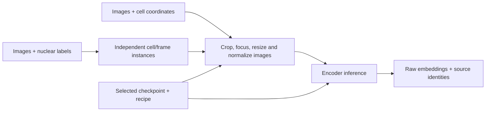

Read the [input contract](../../examples/organelle_dynamics/CONTRACT.md#inputs).
Choose a checkpoint through the [start page](../../examples/organelle_dynamics/README.md).
Request a completed configuration and data paths if they are absent from the conversation or workspace.
Offer the matching template when the user has no configuration.
Ask the user to fill unknown paths and experimental metadata.
Accept any YAML filename; copying the template is optional.
Inspect its contents for unresolved placeholders and missing inputs before execution.
For incompatible inputs, follow [data preparation](../../examples/organelle_dynamics/CONTRACT.md#prepare-external-data) and prepare the missing artifacts.
Ask only for facts that cannot be recovered from the supplied data.
For data without tracking, follow the [independent-instance table contract](../../examples/organelle_dynamics/CONTRACT.md#data-without-tracking).
For supported nuclear labels, replace `cell_index` with `labels` in the configuration.
The same `embed` command prepares independent cell/frame instances before inference.
Supply the actual starting experimental time; multiple frames also require their interval.



```sh
dynacell embed --config /path/to/embedding.yml --output results/embed
```

Use the selected checkpoint's model configuration and image recipe.
Include preprocessing and feature/projection selection in `feature_space`.
Check source-image correspondence on a small sample before full inference.
Preserve cell identities and checkpoint provenance.
Keep generated instance identifiers separate from biological track identities.

The runner verifies checkpoint checksums and rejects classifier configurations.
Pass `predictions.zarr` to phenotype for control normalization and population analysis.
