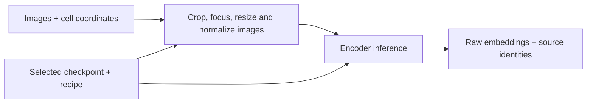

Read the [input contract](../../examples/organelle_dynamics/CONTRACT.md#inputs).
Choose a checkpoint through the [start page](../../examples/organelle_dynamics/README.md).



```sh
uv run --no-sync python -m dynaclr.evaluation.organelle_workflow embed --manifest embed.yaml --output results/embed
```

Use the selected checkpoint's model configuration and image recipe.
Include preprocessing and feature/projection selection in `feature_space`.
Check source-image correspondence on a small sample before full inference.
Preserve cell identities and checkpoint provenance.
Do not manufacture track identities.

The runner verifies checkpoint checksums and rejects classifier configurations.
Pass `predictions.zarr` to phenotype for control normalization and population analysis.
