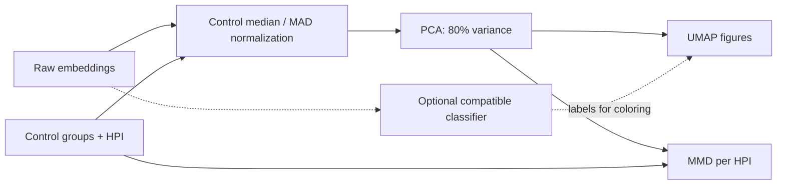

Read the [analysis contract](../../examples/organelle_dynamics/CONTRACT.md#analysis).
Use the environment setup on the [start page](../../examples/organelle_dynamics/README.md#run).
Set `embeddings` to the embed output's `predictions.zarr`.
Request a completed configuration if none is available.
Offer the phenotype template for the user to complete.
Accept any YAML filename and check for unresolved placeholders.
Use [data preparation](../../examples/organelle_dynamics/CONTRACT.md#prepare-external-data) for external embeddings or missing metadata.
Ask for control identities and time references when the supplied data does not establish them.



```sh
dynacell phenotype --config /path/to/phenotype.yml --output results/phenotype
```

Use each marker, experiment and control group's own controls.
Require controls at two or more HPI values per group.
Preserve raw embeddings alongside normalized embeddings.
Compare all treated cells with matched controls, independently of classifier predictions.
Keep model feature spaces separate.
Report insufficient-cell status rows.
Describe subsampling bands as stability intervals.

Optional trusted classifiers consume compatible raw embeddings.
Keep treatment, annotation and prediction fields separate.
Use `normalize` or `plot` commands when only an intermediate output is needed.
Witness scoring and temporal alignment are outside this skill.
