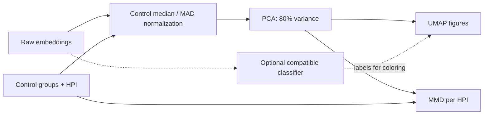

Read the [analysis contract](../../examples/organelle_dynamics/CONTRACT.md#analysis).
Use the environment setup on the [start page](../../examples/organelle_dynamics/README.md#run).
Set `embeddings` to the embed output's `predictions.zarr`.
Use a supplied configuration, or complete the phenotype template from the embedding output and experimental metadata.
Copy `feature_space` from `uns/organelle_feature_space` or the embedding run’s resolved configuration.
Resolve TODO fields; omit metadata and timing defaults when the input already supplies those columns.
Accept any YAML filename and check for unresolved placeholders.
Use [data preparation](../../examples/organelle_dynamics/CONTRACT.md#prepare-external-data) for external embeddings or missing metadata.
Ask for control identities and time references when the supplied data does not establish them.



```sh
dynacell phenotype --config /path/to/phenotype.yml --output results/phenotype
```

Use each marker, experiment and control group's own controls.
Set `normalization.mode` from the requested comparison:

| Mode | Control reference |
| --- | --- |
| `per_timepoint` | Default. Separate median and MAD at every timepoint; controls must exist at each timepoint. |
| `pooled` | One median and MAD from all control observations across timepoints within each group. |

Use `per_timepoint` or `pooled` for single-timepoint data.
Do not smooth control medians or interpolate missing timepoints.
Recompute older smoothed outputs from raw embeddings.
Start from raw embeddings when changing modes.
Preserve raw embeddings alongside normalized embeddings.
Compare all treated cells with matched controls, independently of classifier predictions.
Keep model feature spaces separate.
Report insufficient-cell status rows.
Describe subsampling bands as stability intervals.

Run the CLI after resolving required inputs and report output paths and validation results.
Optional trusted classifiers consume compatible raw embeddings.
Keep treatment, annotation and prediction fields separate.
Use `normalize` or `plot` commands when only an intermediate output is needed.
Witness scoring and temporal alignment are outside this skill.
