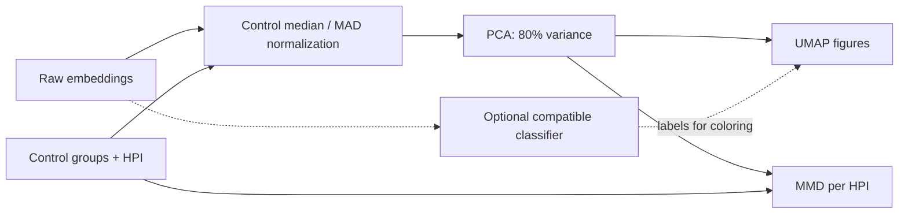

Read the [analysis contract](../../examples/organelle_dynamics/CONTRACT.md#analysis).
Set `embeddings` to the embed output's `predictions.zarr`.



```sh
uv run --no-sync python -m dynaclr.evaluation.organelle_workflow phenotype --manifest phenotype.yaml --output results/phenotype
```

Use each marker, experiment and control group's own controls.
Require controls at two or more HPI values per group.
Preserve raw embeddings alongside normalized embeddings.
Compare all treated cells with matched controls, independently of classifier predictions.
Keep model feature spaces separate.
Report insufficient-cell status rows.
Describe subsampling bands as stability intervals.

Optional trusted classifiers consume compatible raw embeddings.
Keep treatment, annotation and prediction fields separate.
Use `normalize` or `plot` commands when only an intermediate output is needed.
Witness scoring and temporal alignment are outside this skill.
